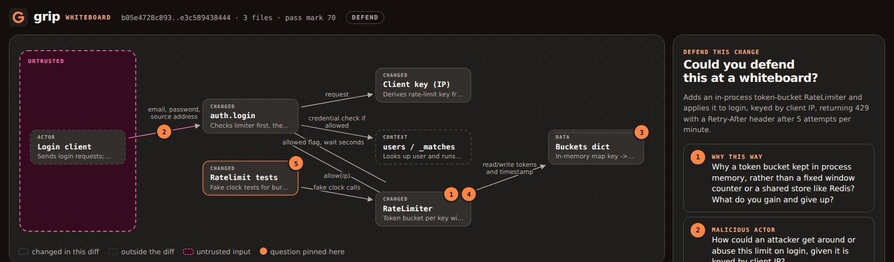
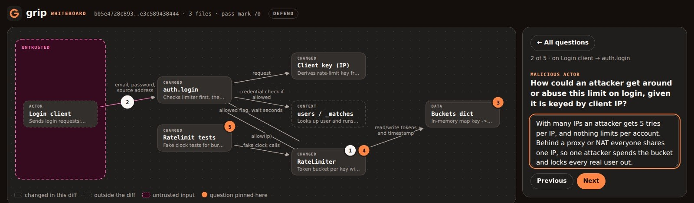
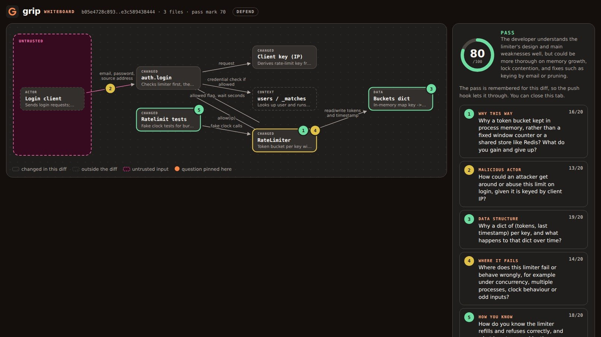
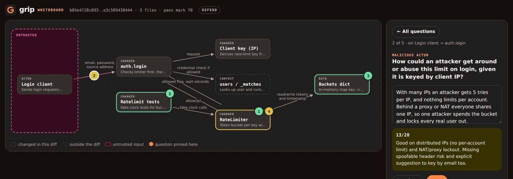

# Walkthrough: one change, from commit to push

This page follows one real change through grip, start to finish. Nothing on it is staged.

- **The repository:** a small JSON API in a sandbox.
- **Git:** `origin` is an ordinary bare repository, so the push is a real `git push`.
- **The model:** Claude Code, which wrote every question, rubric and grade below.

The terminal output is copied from the recorded session and the screenshots are from the
browser tab. Two cuts were made: the waits on the model, and the pause while the questions
were read.

## The change

`notes-api` serves notes behind a login. The change adds a token-bucket rate limiter to
`POST /login`: five attempts per minute per client IP, then `429 Too Many Requests` with a
`Retry-After` header. Three files: a new `api/ratelimit.py`, the call in `api/auth.py`,
and tests that drive the limiter with a fake clock.

```python title="api/ratelimit.py"
class RateLimiter:
    """Allow ``rate`` calls per ``per`` seconds per key, with bursts up to ``rate``."""

    def __init__(self, rate, per, clock=time.monotonic):
        self.rate = rate
        self.per = per
        self.clock = clock
        self._buckets = {}
        self._lock = threading.Lock()

    def allow(self, key):
        """Spend one token for ``key``. Returns (allowed, seconds until the next token)."""
        now = self.clock()
        with self._lock:
            tokens, last = self._buckets.get(key, (self.rate, now))
            tokens = min(self.rate, tokens + (now - last) * self.rate / self.per)
            if tokens < 1:
                self._buckets[key] = (tokens, now)
                return False, (1 - tokens) * self.per / self.rate
            self._buckets[key] = (tokens - 1, now)
            return True, 0.0
```

It is a reasonable change with real trade-offs, which is exactly what grip asks about.

## Set up

grip was installed with `pipx install grip-hook` and the repository set up with
`grip init`. It wrote `provider = "auto"`, which picks Claude Code on this machine; these
are the settings in the `.grip.toml` it wrote that matter here:

```toml title=".grip.toml"
passing_score = 70
difficulty = "normal"
provider = "auto"
```

`grip init` also installed the pre-push hook at `.git/hooks/pre-push`. Both were committed
and pushed before the change, so `origin` holds the code without the limiter.

## Commit, then push

The commit goes through, because grip guards the push, not the commit:

```console
~/notes-api main ❯ git add -A && git commit -m 'Rate-limit login attempts'
[main e3c5894] Rate-limit login attempts
 3 files changed, 74 insertions(+)
 create mode 100644 api/ratelimit.py
 create mode 100644 tests/test_ratelimit.py
```

`git push` runs the hook. grip works out what is about to leave the machine (the commits
`origin` does not have), shows the files and the pass mark, and sends the diff to the
model:

```console
~/notes-api main ❯ git push

╭───────────────────────────────────── grip ──────────────────────────────────────╮
│ 5 questions about your 1 commit on main → origin (pre-push). Pass mark: 70/100. │
│                                                                                 │
│ api/auth.py                                                                     │
│ api/ratelimit.py                                                                │
│ tests/test_ratelimit.py                                                         │
╰─────────────────────────── keep a grip on your code ────────────────────────────╯

Adds an in-process token-bucket RateLimiter and applies it to login, keyed by client IP at 5
attempts/minute. Over-limit requests get a 429 with a Retry-After header. Unit tests cover
bursts, refill and key independence.

Answer in a sentence or two. Press Enter on an empty line to skip.
```

Twelve seconds later, five questions. None of them asks for a line number or a function
name. Each one asks whether you understand a decision the diff made.

## Answer lazily, get blocked

We answered the way someone who pasted the code without reading it would:

```console
Q1/5 (behaviour) Walk through what allow() does with the token count on each call, including
how refill is computed and why the result is capped with min(self.rate, ...).
> it rate limits the login

Q2/5 (edge case) When a request is refused, the code stores (tokens, now) back into the
bucket rather than leaving the entry untouched. Why is that necessary, and what would go
wrong if it didn't update the timestamp?
> not sure

Q3/5 (risk) The limiter is keyed on request.client_address[0] and stored in a process-local
dict. What are the practical weaknesses of this for protecting login, e.g. behind a proxy or
with multiple workers?
> returns a 429

Q4/5 (motivation) Why does login compute Retry-After with math.ceil on the wait and convert
to a string, and why is the rate-limit check placed before the user lookup and password
check?
>

Q5/5 (testing) The tests inject a fake clock. Why, and how does test_burst_then_refused
arrive at wait == 12.0? What scenario is not covered by these tests?
> ran it locally, seemed fine
```

The model grades all five answers in one call:

```console
╭──┬────────────┬───────┬──────────────────────────────────────────────────────────────────╮
│# │ Focus      │ Score │ Feedback                                                         │
├──┼────────────┼───────┼──────────────────────────────────────────────────────────────────┤
│1 │ behaviour  │  1/20 │ Too vague: it doesn't explain proportional refill                │
│  │            │       │ (elapsed*rate/per), the cap at rate, the full starting bucket, or│
│  │            │       │ the spend-one-or-refuse logic.                                   │
│2 │ edge case  │  0/20 │ No answer. The timestamp must advance because the partial refill │
│  │            │       │ is already added to tokens; otherwise the same elapsed time would│
│  │            │       │ be credited twice.                                               │
│3 │ risk       │  0/20 │ "Returns a 429" doesn't address the question. It misses the      │
│  │            │       │ shared proxy IP, per-process buckets across workers or restarts, │
│  │            │       │ many-IP bypass, and unbounded dict growth.                       │
│4 │ motivation │  0/20 │ No answer. It should cover Retry-After as a whole-second string  │
│  │            │       │ via ceil, and the check placed before the expensive pbkdf2 and   │
│  │            │       │ user lookup.                                                     │
│5 │ testing    │  0/20 │ Running it locally doesn't answer why a fake clock is used, how  │
│  │            │       │ wait = 60/5 = 12 comes about, or which scenarios are untested,   │
│  │            │       │ such as the login 429 path, the cap, and concurrency.            │
╰──┴────────────┴───────┴──────────────────────────────────────────────────────────────────╯
╭──────────────────────────────────────────────────────────────────────────────────────────╮
│ Grip Score: 1/100  FAIL (pass mark 70)                                                   │
│                                                                                          │
│ The answers show no real understanding of the rate limiter change: one was vague and off │
│ target, and the rest were blank or irrelevant.                                           │
╰──────────────────────────────────────────────────────────────────────────────────────────╯
grip: Grip Score 1/100 is below the pass mark of 70. Re-read your change and try again.
Report: .git/grip/last-report.json
error: failed to push some refs to '../git-server/notes-api.git'
```

The hook exited 1, so git stopped: **nothing reached `origin`**. The feedback doubles as a
reading list. Q3's feedback alone names four weaknesses of the change: a proxy that makes
every user share one IP, per-process buckets, attackers with many IPs, and a dictionary
that never shrinks.

### What the grader was holding

Each question was written together with a rubric, before we answered. The rubric never
reaches the terminal; it stays in the report on the developer's machine. This is the
rubric for Q2:

> Refill is computed from the last timestamp; the partial refill up to now has already
> been added to tokens, so the timestamp must advance to avoid counting the same elapsed
> time twice (double-crediting tokens). Without it, refused attempts would let tokens
> refill too fast.

That is why grading is consistent: the grader checks an answer against points fixed in
advance, not against its own fresh opinion. More on that in
[How grip works](internals.md#rubrics-and-grading).

## Defend it at the whiteboard

The terminal quiz is one way to pass. The other is to defend the change in the browser.
The diff is now a commit, not staged changes, so we point grip at the unpushed commits:

```console
~/notes-api main ❯ grip whiteboard --unpushed
http://127.0.0.1:35515/AjTJipMh_pF2PxAAQHDQRw/
grip: the whiteboard is open at the address above. Answer there; this waits until you hand
in (Ctrl-C to stop).
```

The model drew the change the way you would sketch it for a colleague. It also picked
different questions this time, aimed at what a whiteboard is good at:



Reading the board:

- **The pink zone** holds what an outsider controls: here, the login client and everything
  it sends. Arrows that cross into it are trust boundaries.
- **"Changed" boxes** are code in this diff. **Dashed boxes** are existing code the
  change calls (`users / _matches`).
- **The orange pins** are the five questions, each attached to the part it is about. Pin 2
  sits on the arrow from the client into `auth.login`, because it asks what an attacker
  could do with that request.

Click a pin, read the question, answer in a sentence or two:



Our five answers, and what the model gave them:

| # | Kind | Our answer, in short | Score |
| --- | --- | --- | --- |
| 1 | why this way | A bucket allows a burst then refills smoothly, with no double burst at a window edge; in memory, so no Redis, but per process | 16/20 |
| 2 | malicious actor | Many IPs get 5 tries each and nothing limits per account; behind a proxy one attacker locks everyone out | 13/20 |
| 3 | data structure | Two numbers per key, refilled lazily in O(1); nothing deletes a key, so memory grows without bound | 19/20 |
| 4 | where it fails | N workers allow N times the rate, a deploy resets it; the lock and monotonic clock are fine | 14/20 |
| 5 | how you know | The fake-clock tests prove the burst, the 12 s wait and the refill; untested: the 429 wiring, threads, processes | 18/20 |

Hand in, and the page shows the score, colours each pin by how well it went, and keeps
the per-answer feedback one click away:





80/100 is a pass, and the feedback is still honest about what we missed: we never said
how to fix the memory growth (prune idle buckets), and never suggested also keying on the
email address. The terminal agrees:

```console
grip: Grip Score 80/100. Defended.
```

## Push again

```console
~/notes-api main ❯ git push
grip: this exact diff already passed recently, skipping the quiz.
Enumerating objects: 11, done.
Counting objects: 100% (11/11), done.
Delta compression using up to 4 threads
Compressing objects: 100% (7/7), done.
Writing objects: 100% (7/7), 1.52 KiB | 1.52 MiB/s, done.
Total 7 (delta 3), reused 0 (delta 0), pack-reused 0
To ../git-server/notes-api.git
   b05e472..e3c5894  main -> main
```

The hook did not ask again. A pass is stored as a fingerprint (SHA-256) of the exact
patch, and the push carried the same patch the whiteboard just defended. Change one line
and the fingerprint changes, so the next push asks again. Passes are remembered for
`remember_passes_hours`, 24 by default.

```console
~/notes-api main ❯ git log --oneline -3 origin/main
e3c5894 (HEAD -> main, origin/main) Rate-limit login attempts
b05e472 Set up grip
688e584 notes-api: login, notes, users
```

## What is left on disk

Everything grip keeps is inside the repository's `.git` directory, never committed:

```text
.git/grip/
├── last-report.json   the latest graded quiz: questions, rubrics, answers, grades
├── history.jsonl      one line per graded quiz (here: the 1/100, then the 80/100)
└── passed.json        fingerprints of passed diffs: when, the score, the pass mark, the grader
```

The diff and the answers went to the model (Claude Code, here). Nothing else left the
machine.

## Next

- [Install](getting-started.md) and set up your own repository.
- [The whiteboard](whiteboard.md): interview mode, sharing a board, and the page itself.
- [How grip works](internals.md): the pipeline, the prompts, grading, and the hook
  mechanics in detail.
