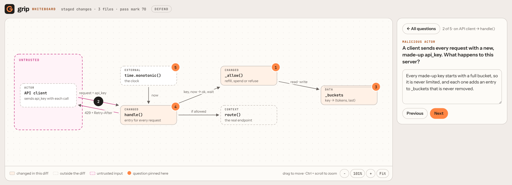

# The whiteboard

`grip whiteboard` is the [whiteboard defense](whiteboard-defense.md) as a command. grip
draws your change the way you would sketch it for a colleague: its parts, how they
connect, which inputs are untrusted. It pins five questions to the drawing and opens it in
your browser. Click a part, answer, hand in.



```bash
grip whiteboard            # your staged change
grip whiteboard --unpushed # everything not yet on a remote
```

## From the hook

The command is one way in; the git hook is the other. Set `hook_mode` and every commit or
push the hook guards is defended on the board instead of quizzed in the terminal:

```toml
# .grip.toml
hook_mode = "whiteboard"
```

The hook prints the address, opens the browser and waits for you to hand in. A pass lets
the push through; a score below the mark blocks it, and the page shows what each answer
missed. Where no browser can be opened (over SSH, no display) the hook asks in the
terminal as usual. Retrying the same diff reuses the board, so only the grading runs again.

## What it asks

Every board asks three things, and two more when the change calls for them:

| Question | When |
| --- | --- |
| **Why this way**: why X and not Y; the model has to name a real alternative | always |
| **Where it fails**: the input, load or state that breaks it | always |
| **How you know**: how you would show it works | always |
| **Malicious actor**: what a hostile caller, input or tenant can do | the change takes untrusted input |
| **Data structure**: why this representation, and what it costs | the change adds or changes data |
| **How it works**: what the change does, in your words | fills any slot left |

Five questions, 20 points each. The Grip Score and the pass mark mean exactly what they mean
for `grip quiz`, and a pass is remembered for the diff, so the push hook and the Claude
Code push gate let it through.

## Reading the board

- **Solid boxes** are code the diff changes. **Dashed boxes** are outside it: callers,
  services, the code it calls.
- The **pink area** holds untrusted input. Arrows crossing into it are where the
  malicious-actor question usually sits.
- **Numbered pins** are the questions. After you hand in, each pin and the box it sits on
  turn green, yellow or red, and the panel shows what each answer missed.

## Keyboard

Everything works without a mouse. Tab reaches the boxes and pins in turn, and a skip link
jumps straight to the questions. On a pin, the arrow keys move to the next or previous
pin; Enter opens it. Keys `1` to `5` open a question from anywhere except an answer box,
and Esc goes back to the list. Focus stays where you were when the page redraws, and a
screen reader hears each pin's state (not answered, answered, scored 14 of 20) and the
score once it is graded.

## Interview mode

```bash
grip whiteboard --range main..feature --interview
```

For the person doing the pulling aside. The rubric for each question is visible and has a
checkbox per point: ask aloud, tick what you hear, hand in for a score. Nothing is recorded
and the answers never go to a model, so it works for a review over coffee as well as for a
pairing session.

## Sharing a board

```bash
grip whiteboard --export board.html
```

Writes one self-contained page with the drawing and the questions, without rubrics and
without grading. Attach it to a pull request so reviewers know what the author should be
able to defend.

## From a coding agent

`/grip-whiteboard` in Claude Code, Codex, Gemini CLI or Cursor starts the whiteboard and
waits. You answer in the browser, so your answers never pass through the agent's
conversation; the agent reports the score at the end. See [coding agents](agents.md).

## How it is built

- One model call draws the board. grip checks it before showing anything: every arrow and
  pin points at a real part, every changed part names files that are in the diff, and the
  required questions are there. If the board fails a check, grip asks once more with the
  problems listed, then falls back to telling you to run `grip quiz`.
- grip lays the board out itself, so the same board always looks the same.
- The page is served on `127.0.0.1` on a random port, behind a random token. It accepts only
  its own address as `Host` and `Origin`, and its Content-Security-Policy allows nothing but
  its own inline script and style. Rubrics never reach the page in defend mode.
- Everything the model wrote is shown as text, never as markup, so a diff that tries to
  inject a script into the drawing only gets a strange label.
- Like the terminal quiz, it cannot stop someone on your machine from answering for you: a
  program that can read the address can post to it. grip checks understanding; it is not an
  exam proctor.

The full design, including the decisions and where it fails, is in
[Design: grip whiteboard](design/whiteboard.md).
